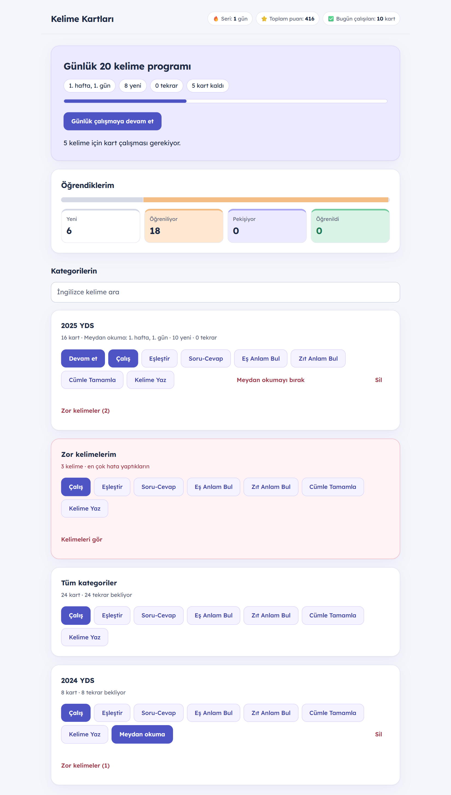
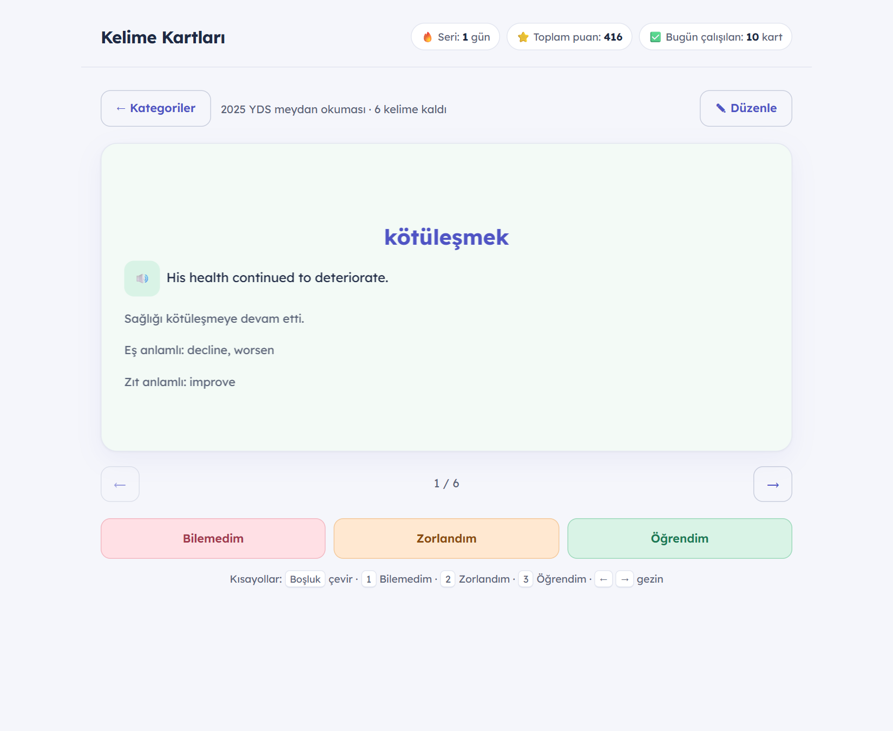
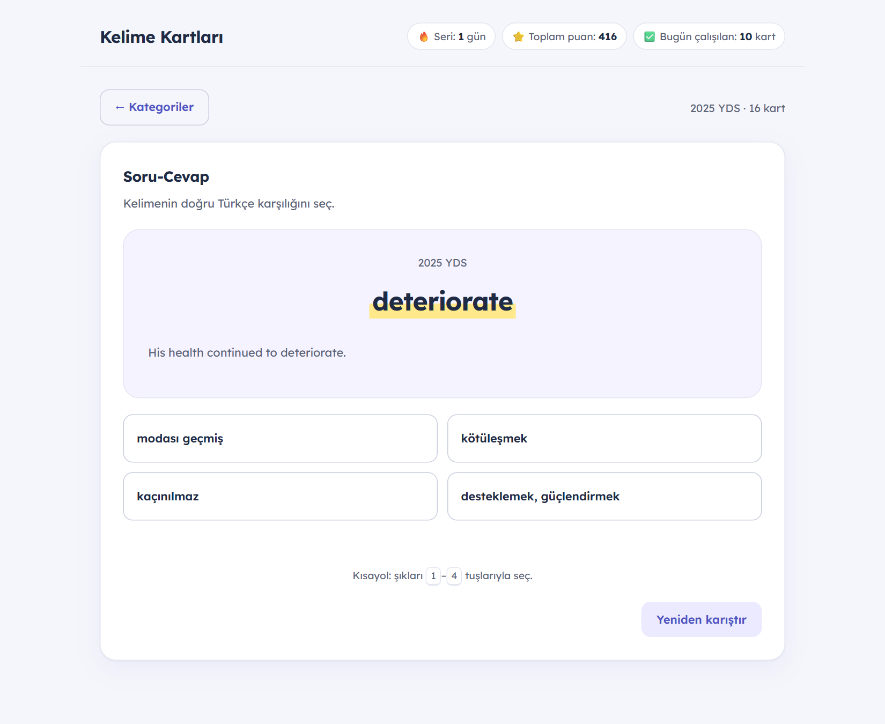
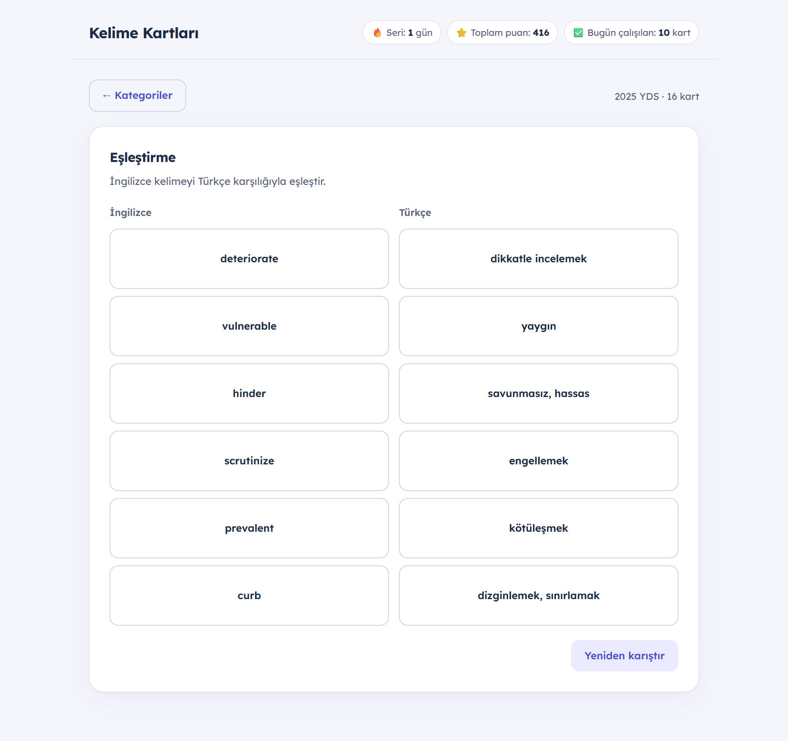
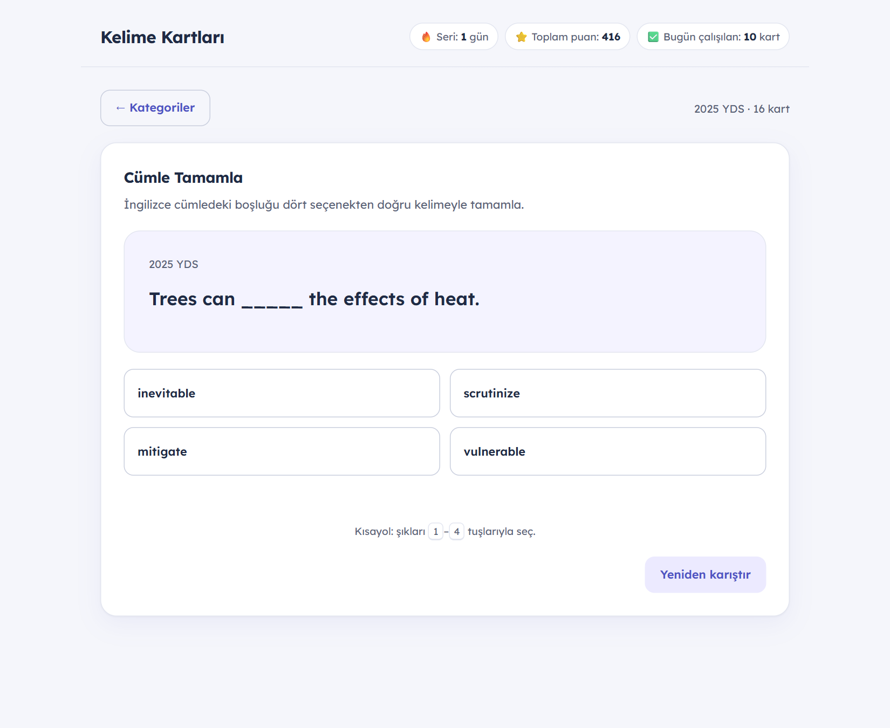
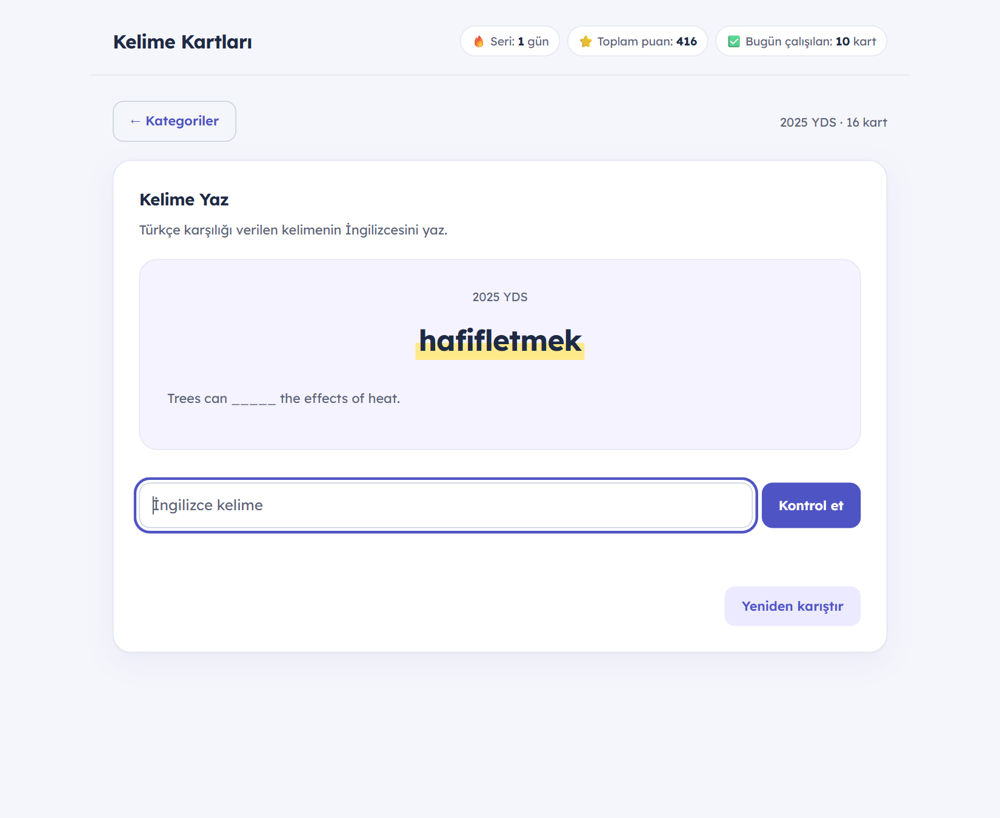

# YDS Kelime Platformu

YDS ve benzeri sınavlara hazırlananlar için aralıklı tekrara dayalı bir kelime çalışma uygulaması. Kendi kelime listeni yüklersin; uygulama her gün hangi kelimeleri çalışacağını belirler, kartlar ve oyunlarla pekiştirir, zorlandığın kelimeleri ayrıca takip eder.

Kurulum, sunucu veya hesap gerekmez: `index.html` dosyasını tarayıcıda açman yeterli. Bütün veriler kendi tarayıcında kalır.



| Kart çalışması | Soru-Cevap |
| --- | --- |
|  |  |
| **Eşleştirme** | **Cümle Tamamla** |
|  |  |
| **Kelime Yaz** | |
|  | |

## İçindekiler

- [Özellikler](#özellikler)
- [Başlarken](#başlarken)
- [Kelime listesi biçimi](#kelime-listesi-biçimi)
- [Nasıl çalışır](#nasıl-çalışır)
- [Klavye kısayolları](#klavye-kısayolları)
- [Veriler ve yedekleme](#veriler-ve-yedekleme)
- [Geliştirme](#geliştirme)

## Özellikler

**Çalışma**
- Günlük 20 kelimelik program: 1, 3, 7, 14 ve 30 gün aralıklı tekrar, her hafta bir genel tekrar günü
- Kategori meydan okuması: her kategori için günde 10 kelimelik ayrı program (örneğin `2025 YDS`, `2024 YDS`)
- Serbest çalışma: herhangi bir kategoriyi istediğin zaman Leitner kutularıyla çalışma
- `Zor kelimelerim`: en çok hata yapılan 40 kelimeden otomatik oluşan kategori; her kategorinin ayrıca kendi zor kelimeler listesi
- `Öğrendiklerim` paneli: her kelimenin Yeni, Öğreniliyor, Pekişiyor veya Öğrenildi seviyesi
- En son çalışılan kategori listenin en üstünde

**Oyunlar**
- Soru-Cevap: İngilizce kelimenin dört şıktan Türkçe karşılığını bulma
- Eşleştirme: İngilizce ve Türkçe kelimeleri eşleştirme
- Cümle Tamamla: örnek cümledeki boşluğu dört İngilizce seçenekten doldurma
- Eş Anlam Bul ve Zıt Anlam Bul
- Kelime Yaz: Türkçe karşılığı verilen kelimenin İngilizcesini yazma

**Kelime yönetimi**
- CSV, TXT ve XML dosyasından toplu yükleme; tekrar eden ve hatalı satırlar için yükleme raporu
- Tek tek kelime ekleme, kart ekranından düzenleme ve silme
- Kelime arama: İngilizce bir kelimenin listede olup olmadığını ve hangi kategoride olduğunu gösterir
- İngilizce kelime ve örnek cümleler için sesli okuma
- JSON yedek indirme ve başka bir cihaza geri yükleme

## Başlarken

1. Depoyu indir veya klonla:
   ```bash
   git clone https://github.com/gizembm/yds-vocab-platform.git
   ```
2. `index.html` dosyasını tarayıcıda aç.
3. Ana ekrandaki `Kelime ekle` bölümünden bir kelime listesi yükle veya kelimeleri elle ekle.
4. `Günlük 20 kelime programı` panelinden programı başlat ya da bir kategori satırındaki `Meydan okuma` butonuna bas.

> CSV dosyalarının okunması için uygulama PapaParse kütüphanesini CDN üzerinden yükler; dosya yüklerken internet bağlantısı gerekir.

## Kelime listesi biçimi

Her satır bir kelimedir. Sütun sırası:

| Sütun | Zorunlu | Örnek |
| --- | --- | --- |
| Kategori | Evet | `2025 YDS` |
| İngilizce kelime | Evet | `mitigate` |
| Türkçe karşılığı | Evet | `hafifletmek` |
| Örnek cümle | Hayır | `Trees can mitigate the effects of heat.` |
| Cümle çevirisi | Hayır | `Ağaçlar sıcağın etkilerini hafifletebilir.` |
| Eş anlamlılar | Hayır | `alleviate, ease` |
| Zıt anlamlılar | Hayır | `aggravate` |

**CSV / TXT** (UTF-8, virgülle ayrılmış; virgül içeren alanları tırnak içine al):

```csv
Kategori,İngilizce,Türkçe,Örnek cümle,Çeviri,Eş anlamlı,Zıt anlamlı
2025 YDS,mitigate,hafifletmek,Trees can mitigate the effects of heat.,Ağaçlar sıcağın etkilerini hafifletebilir.,"alleviate, ease",aggravate
```

İlk hücresinde "Kategori" yazan başlık satırı otomatik atlanır. Excel'den kaydederken `CSV UTF-8` biçimini seç.

**XML**: Kök öğenin her alt öğesi bir kelimedir; onun alt öğeleri yukarıdaki sırayı izler (öğe adları önemli değildir).

```xml
<words>
  <word>
    <category>2025 YDS</category>
    <en>mitigate</en>
    <tr>hafifletmek</tr>
    <example>Trees can mitigate the effects of heat.</example>
    <exampleTr>Ağaçlar sıcağın etkilerini hafifletebilir.</exampleTr>
    <synonyms>alleviate, ease</synonyms>
    <antonyms>aggravate</antonyms>
  </word>
</words>
```

Aynı kategoride aynı İngilizce kelime ikinci kez eklenmez.

## Nasıl çalışır

### Günlük program

Gün İstanbul saatine göre belirlenir. Her hafta 1–6. günlerde 20 yeni kelime açılır; 7. gün yeni kelime gelmez ve haftanın kelimeleri tekrar edilir. Öğrenilen kelime 1, 3, 7, 14 ve 30 gün sonra tekrar gelir.

Bir günün kartları şu sırayla gelir:

1. Unutulan kelimeler (`Bilemedim` veya `Zorlandım` denmiş)
2. Bir önceki çalışma gününün yeni kelimeleri
3. Tekrar zamanı gelmiş kelimeler (en çok geciken önce)
4. 7. günde haftanın kalan kelimeleri
5. Bugünün yeni kelimeleri

| Sınır | Değer |
| --- | --- |
| Günlük yeni kelime | 20 |
| Günlük tekrar kartı | en çok 60 (fazlası sonraki güne kalır) |
| Günlük toplam kart | en çok 80 |

Zamanı gelen tekrarlar 60'ı aşarsa o gün yeni kelime açılmaz ve boşalan yer tekrarlara verilir.

**Kart puanlaması**

| Buton | Yeni kelime | Tekrar kelimesi |
| --- | --- | --- |
| `Öğrendim` | Öğrenilir, 1 gün sonra gelir | Zamanı geldiyse bir sonraki basamağa geçer; zamanı gelmediyse takvim değişmez |
| `Zorlandım` | Öğrenilir, bugün bir kez daha gösterilir | Bir basamak düşer, yarın gelir |
| `Bilemedim` | Sıfırlanır, bugün tekrar sorulur | Sıfırlanır, bugün tekrar sorulur |

**Günün oyunları**: Kartlar bitince Test, Eşleştirme ve Cümle Tamamla açılır; Eş Anlam Bul, Zıt Anlam Bul ve Kelime Yaz isteğe bağlıdır. Oyunlar yalnızca bugünün yeni kelimeleri ve kartlarda zorlanılan kelimelerle oynanır; eski tekrarlar yalnızca kartla geçilir. Oyunda yanlış yapılan kelime bir basamak düşer, yarın tekrar gelir ve bugün kart çalışmasına geri eklenir (eşleştirmede yalnızca seçilen İngilizce kelime hatalı sayılır). Kartlar ve zorunlu oyunlar bitince `Sonraki güne geç` ile hemen yeni güne geçilebilir.

**Serbest çalışma** günlük programı yalnızca hatalarda etkiler: öğrenilmiş bir kelimede yapılan hata onu bir basamak düşürüp yarınki tekrara ekler; doğru cevaplar takvimi değiştirmez.

### Kelime Yaz

Türkçe karşılık ve varsa kelimesi boş bırakılmış örnek cümle gösterilir; İngilizcesi yazılıp `Enter` ile kontrol edilir. Bütün kategorilerde, zor kelime listelerinde, günlük programda ve meydan okumalarda oynanır.

- Büyük/küçük harf, fazla boşluk ve Türkçe klavyeden gelen `İ`/`ı` hata sayılmaz.
- Dört harf veya daha uzun bir kelimede tek harflik hatada bir hak daha verilir; ikinci hatalı deneme yanlış sayılır.
- Aynı Türkçe karşılığa sahip başka bir kelime de doğru kabul edilir.

### Kategori meydan okuması

Her kategori satırındaki `Meydan okuma` butonu, o kategori için ayrı bir günlük program başlatır. Kurallar günlük programla aynıdır, sayılar yarıya iner: günde 10 yeni kelime, en çok 30 tekrar ve toplam 40 kart. Birden fazla kategorinin meydan okuması aynı anda sürebilir.

- Meydan okuması süren kategorinin kelimeleri ana programdan çıkar; her kelimenin tek bir tekrar takvimi olur. Öğrenilmiş kelimeler basamak ve tekrar tarihleriyle taşınır, henüz öğrenilmemiş kelimeler meydan okumada yeni kelime olarak gelir.
- Kategori satırında hafta/gün ile yeni ve tekrar sayıları görünür; `Devam et` meydan okumayı açar.
- Yeni kelimeler bitince meydan okuma tekrarlarla sürer. Bütün kelimeler `Öğrenildi` seviyesine gelince satırda `Tamamlandı` yazar.
- `Meydan okumayı bırak` kelimeleri ilerlemeleriyle ana programa geri verir. Kategoriye sonradan eklenen kelimeler meydan okumada yeni kelime olarak sıraya girer; kategori silinirse meydan okuması da silinir.

### Öğrendiklerim

| Seviye | Anlamı |
| --- | --- |
| Yeni | Henüz programa girmedi |
| Öğreniliyor | İlk tekrarını bekliyor |
| Pekişiyor | 3, 7 veya 14 günlük basamakta |
| Öğrenildi | 14 günlük tekrarı da geçti, artık 30 günde bir gelir |

Öğrenilen kelimeler bir sonraki tekrar tarihleriyle listelenir.

### Zor kelimelerim

Her kelimenin bir hata puanı vardır. Puanı 2 ve üzeri olan en fazla 40 kelime, ana ekranda `Zor kelimelerim` adlı kategoride toplanır; kartlar ve bütün oyunlar bu listeyle de oynanabilir.

- Hata puanı beş kaynağın toplamıdır: kartlar, Soru-Cevap, Eşleştirme, Cümle Tamamla ve Kelime Yaz. Her kaynak 0–8 arasında tutulur.
- Yanlış cevap ve `Bilemedim` +2, `Zorlandım` +1 ekler; doğru cevap 1 düşürür.
- Kartlarda `Öğrendim`, puanı en yüksek kaynaktan düşürür. Böylece oyunlarda zorlanılan bir kelime kartlarla da listeden çıkarılabilir.

Her kategorinin kendi zor kelimeleri de aynı kurallarla, kategori satırının altındaki `Zor kelimeler (N)` bölümünde listelenir. Bölüm açılınca yalnızca o kategorinin zor kelimeleriyle `Çalış`, `Eşleştir`, `Soru-Cevap`, `Cümle Tamamla` ve `Kelime Yaz` oynanabilir. Zor kelime çalışmasında kartlar tekrar tarihini beklemeden, en zor kelimeden başlayarak gelir.

### Kelime arama

Ana ekrandaki `İngilizce kelime ara` kutusu bütün kategorilerde yalnızca İngilizce kelimeleri arar (büyük/küçük harf fark etmez). Birebir eşleşen kelimeler önce, sonra aranan ifadeyle başlayan ve onu içeren kelimeler gelir. Her sonuçta Türkçe karşılık, kelimenin bulunduğu kategori ve öğrenme seviyesi görünür; ilk 20 sonuç listelenir.

## Klavye kısayolları

| Tuş | İşlev |
| --- | --- |
| `Boşluk` | Kartı çevir |
| `1` / `2` / `3` | Bilemedim / Zorlandım / Öğrendim |
| `←` / `→` | Önceki / sonraki kart |
| `1`–`4` | Oyunlarda şık seç |

## Veriler ve yedekleme

Kelimeler ve bütün ilerleme yalnızca tarayıcının `localStorage` alanında saklanır; hiçbir sunucuya gönderilmez. Tarayıcı verilerini silmek ilerlemeyi de siler.

- `Yedeği indir` tüm veriyi bir `.json` dosyasına kaydeder.
- `Yedeği yükle` bu dosyayı aynı veya başka bir cihaza geri yükler; o cihazdaki verinin yerine geçer.
- Uygulama, tarayıcının veriyi kendiliğinden silmemesi için kalıcı depolama izni ister.

## Geliştirme

Uygulama derleme adımı olmayan düz JavaScript'tir (klasik `<script>` dosyaları, `file://` üzerinden çalışır). Testler ve ekran görüntüsü betiği için Node.js 18 veya üstü gerekir.

```bash
npm test                # Bütün testleri çalıştırır (bağımlılık gerekmez)
npm install             # Yalnızca ekran görüntüsü betiği için
npm run screenshots     # docs/screenshots altındaki görüntüleri örnek kelimelerle yeniden alır
```

Ekran görüntüsü betiği bilgisayardaki Chrome'u (yoksa Edge'i) kullanır; başka bir tarayıcı için `CHROME_PATH` ortam değişkenini ver.

### Proje yapısı

```text
index.html                 # Ekran iskeleti ve sıralı script yüklemesi
src/
  js/
    core/                  # Ayarlar, yardımcılar, kalıcı veri, geçici oturum
    features/
      audio/               # İngilizce seslendirme
      backup/              # JSON yedek indirme/yükleme
      daily/               # Günlük program, kategori meydan okuması, günün oyunları
      decks/               # Kategori listesi, istatistikler, kategori ekleme
      games/               # Eşleştirme, Soru-Cevap, Cümle Tamamla, Kelime Yaz
      import/              # CSV/XML okuma ve yükleme raporu
      navigation/          # Ana ekran ve oyun ekranı geçişleri
      progress/            # Öğrendiklerim seviyeleri ve listesi
      shortcuts/           # Klavye kısayolları
      study/               # Kartlar ve serbest Leitner çalışması
      words/               # Elle ekleme, düzenleme, silme ve kelime arama
    bootstrap.js           # Olay bağlantıları ve ilk ekranın açılması
  styles/                  # Tema, düzen, ekran ve mobil stilleri
scripts/
  screenshots.cjs          # README ekran görüntüleri
tests/                     # node:test ile davranış testleri
docs/
  architecture.md          # Modül sözleşmeleri ve geliştirme rehberi
  screenshots/             # README görselleri
```

Kayıt anahtarı (`flashcards_v1`) ve veri biçimi geriye dönük uyumludur; eski kayıtlar ve yedekler dönüştürme gerektirmeden açılır. Yeni bir geliştirmeye başlamadan önce [mimari rehberini](docs/architecture.md) oku.
